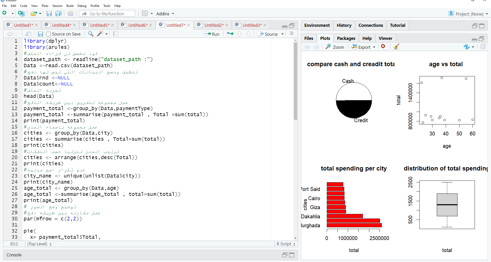
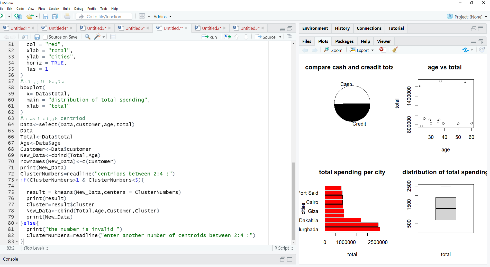

# Retail Customer Analysis with R

Exploratory analysis of grocery transactions, with spending visualizations, K-means clustering, and an Apriori association-rule workflow captured in RStudio screenshots.

**Tools shown:** R, RStudio, dplyr, arules, readxl, and base R plotting.

## Overview

The project examines spending by payment method, city, and age, then explores clusters using transaction totals and customer age. Screenshots also show code for mining item associations with configurable support and confidence.

## Available materials

| Path | Contents |
| --- | --- |
| `data/payment_summary.csv` | Aggregate payment totals, with individual records excluded |
| `screenshots/` | Selected original screenshots of code and aggregate visualizations, without customer names |
| `docs/analysis-notes.md` | Workflow, data fields, and interpretation notes |

## Dataset snapshot

The supplied CSV contains **9,835 records** and eight fields: `items`, `count`, `total`, `rnd`, `customer`, `age`, `city`, and `paymentType`.

| Payment method | Sum of `total` |
| --- | ---: |
| Cash | 6,402,349 |
| Credit | 6,311,875 |
| Overall | 12,714,224 |

These totals were recalculated directly from the supplied CSV. The dataset does not specify a currency. A row represents a transaction, not a unique customer.

## Analysis preview

## Implementation status

The original `.R` source files are unavailable. This repository preserves aggregate payment totals and selected visual evidence of the implementation, with a written explanation. It does not currently provide a runnable analysis script. Association-rule code is visible, but no verified rule output is included in the inspected screenshots.

Individual transaction records and screenshots containing customer names are excluded from this public repository. The original dataset author and license are not included in the supplied materials. No ownership of the underlying dataset is claimed.
